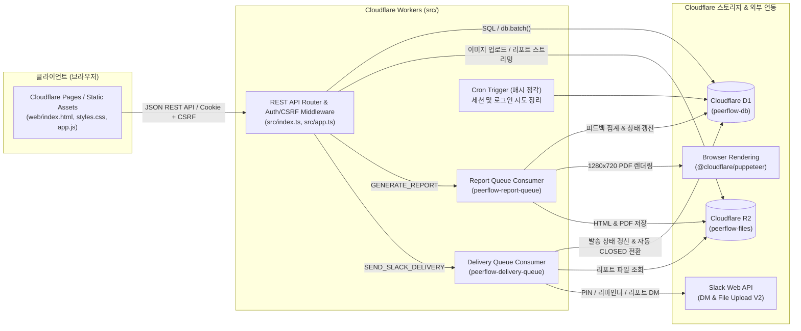
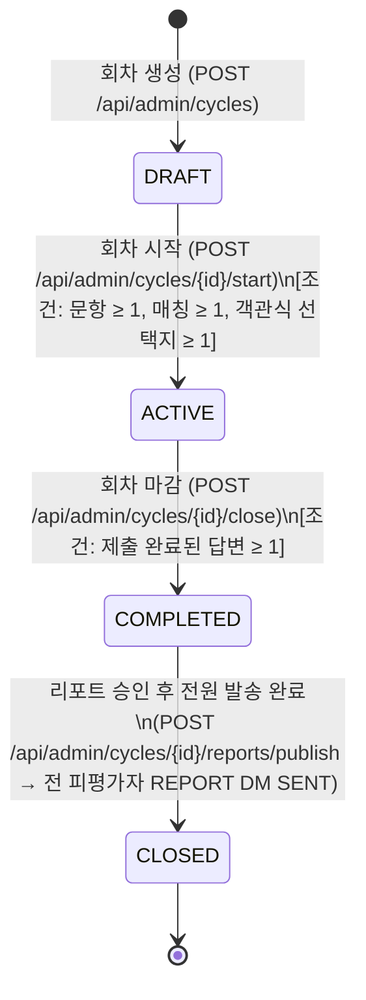

# 02. 서버리스 아키텍처 및 서비스 파이프라인

본 문서는 **PeerFlow v2**의 Cloudflare 서버리스 아키텍처 구성과 4단계 서비스 파이프라인(`DRAFT` → `ACTIVE` → `COMPLETED` → `CLOSED`)의 동작 방식을 설명합니다.

---

## 1. 시스템 아키텍처

### 1.1 주요 컴포넌트 역할
* **`web/` (SPA 클라이언트)**:
  * 바닐라 ES Module 기반의 경량 SPA로, 관리자 화면과 리뷰어 화면을 모두 제공합니다.
  * **라이트/다크 모드** 토글(`localStorage` 및 OS 테마 연동), **민감 작업 확인 모달(`showConfirmModal`)**, **중복 클릭 방지 잠금(`withAsyncLock`)**이 내장되어 있습니다.
  * `wrangler.jsonc`의 `"run_worker_first": true` 설정을 통해 `/api/*` 경로(새 탭에서 여는 HTML/PDF 미리보기 포함)는 항상 Worker가 먼저 처리하고, 그 외 경로만 SPA 에셋으로 폴백됩니다.
* **`src/` (Cloudflare Workers 백엔드)**:
  * Web Crypto API(`PBKDF2-HMAC-SHA256`, `SHA-256`, CSPRNG)만을 사용하여 외부 네이티브 의존성 없이 인증·해싱을 수행합니다.
  * 모든 상태 변경 요청(`POST`, `PATCH`, `PUT`, `DELETE`)에 대해 `HttpOnly` 세션 쿠키(`peerflow_session`)와 `X-CSRF-Token` 헤더를 동시에 검증합니다.
* **`REPORT_QUEUE` & Browser Rendering (`src/reporting/generator.ts`)**:
  * 회차 마감 시 피평가자별 리포트 생성 작업을 비동기로 처리합니다.
  * Cloudflare Browser Rendering의 브라우저 실행 속도 제한(`429`)을 방지하기 위해 **큐 배치당 단일 HeadlessChrome 인스턴스(`sharedBrowser`)를 실행하여 여러 피평가자의 PDF를 탭(`newPage`) 단위로 연속 렌더링**합니다.
  * 생성 실패(`FAILED`) 시 **15초 주기로 자동 재시도**(`msg.retry({ delaySeconds: 15 })` 및 리포트 목록 폴링 시 자동 재큐잉)합니다.
* **`DELIVERY_QUEUE` & Slack 연동 (`src/slack/delivery.ts`)**:
  * Slack `users.lookupByEmail`, `conversations.open`, `chat.postMessage`, `files.getUploadURLExternal` / `files.completeUploadExternal`(V2 파일 업로드) API를 통해 DM 및 HTML·PDF 파일을 발송합니다.
  * `MOCK_SLACK_MODE="true"` 설정 시 실제 Slack 호출 없이 Workers 로그에 수신자 정보와 6자리 로그인 PIN 코드·메시지 전문을 출력하고 즉시 `SENT`로 기록합니다.

---

## 2. 회차(Cycle) 4단계 상태 머신 및 파이프라인

회차(`cycles.status`)는 **`DRAFT` → `ACTIVE` → `COMPLETED` → `CLOSED`**의 단방향 생명주기를 따릅니다.

### Phase 1. 준비 단계 (`DRAFT`)
1. **팀원 등록**: 단건 등록 또는 CSV 일괄 업로드(`name,email,department,slack_user_id`)로 팀원을 등록합니다.
2. **회차 생성**: 제목, 시작·마감 일시, 리뷰어 안내 문구를 입력하여 `DRAFT` 회차를 생성합니다.
3. **설문 문항 및 선택지 구성**:
   * `RATING`(5점 척도), `TEXT`(서술형), `SINGLE_CHOICE`(단일 선택), `MULTIPLE_CHOICE`(다중 선택) 문항을 등록합니다.
   * 필요 시 문항별 참고 이미지(PNG/JPEG/WebP, **최대 10MB**)를 첨부할 수 있으며, R2에 사람이 읽기 쉬운 경로로 저장됩니다.
   * 동일 문항 내 동일한 선택지 텍스트는 DB `UNIQUE (question_id, option_text)` 제약 및 API 검증으로 중복 추가가 차단됩니다.
4. **리뷰 매칭 설정**: 수동 배정 또는 자동 매칭(`ALL` 전체 교차 / `SAME_DEPARTMENT` 동일 부서 교차)으로 리뷰어-피평가자 쌍을 생성합니다.

### Phase 2. 수집 단계 (`ACTIVE`)
1. **회차 시작 (`DRAFT` → `ACTIVE`)**:
   * 설문 문항과 선택지가 잠기며 더 이상 문항을 추가·수정·삭제할 수 없습니다.
   * 배정된 모든 리뷰어에게 회차 전용 **6자리 숫자 PIN**이 발급되고 `DELIVERY_QUEUE`를 통해 Slack DM(`PIN_ISSUE`)이 발송됩니다.
   * `ACTIVE` 상태에서도 새로운 리뷰 매칭을 추가할 수 있으며, 신규 리뷰어에게는 즉시 PIN이 발급·발송됩니다.
2. **리뷰어 PIN 로그인 및 리뷰 작성**:
   * 리뷰어는 6자리 PIN으로 로그인하여 본인에게 배정된 피평가자 목록을 확인합니다.
   * 작성 중 언제든 **임시 저장(Draft)**할 수 있으며, 모든 문항에 응답한 후 **최종 제출(Submit)**하면 D1 `db.batch()` 트랜잭션으로 답변이 저장되고 해당 배정이 잠깁니다(`is_submitted = 1`).
3. **미제출 리마인더 발송**:
   * 관리자는 마감 전 언제든 미제출 리뷰어에게 리마인더 DM(`REMINDER`)을 발송할 수 있습니다.
   * 현재 큐에 대기 중(`PENDING`)인 리마인더가 없는 한 횟수 제한 없이 반복 발송이 가능합니다.

### Phase 3. 마감 및 리포트 생성 단계 (`COMPLETED`)
1. **회차 마감 (`ACTIVE` → `COMPLETED`)**:
   * **최소 1개 이상의 제출된 피어리뷰 답변**이 존재해야 회차를 마감할 수 있습니다(미충족 시 `409 STATE_CONFLICT`).
   * 마감 즉시 리뷰어의 추가 임시 저장 및 제출이 차단되고, 피평가자별 `reports` 레코드(`generation_status = 'PENDING'`)가 생성되어 `REPORT_QUEUE`에 등록됩니다.
2. **익명 집계 및 HTML·PDF 이중 생성**:
   * 제출된(`is_submitted = 1`) 답변만 집계하며, 작성자(`reviewer_id`) 정보는 리포트에서 완전히 제거되고 서술형 답변은 가나다순으로 정렬되어 익명성이 보장됩니다.
   * 1280×720 가로형 슬라이드 규격의 독립형 HTML(SVG 차트 및 Base64 이미지 내장)과 HeadlessChrome 기반 PDF가 생성되어 R2에 저장됩니다.
   * 생성 실패(`FAILED`) 시 **15초 주기로 자동 재시도**되어 모든 리포트가 `READY` 상태에 도달합니다.

### Phase 4. 승인·배포·종료 단계 (`CLOSED`)
1. **리포트 미리보기 및 일괄 승인·발송 (`publish`)**:
   * 관리자는 리포트 탭에서 각 피평가자의 HTML 및 PDF 리포트를 새 탭으로 열람하여 확인합니다.
   * 모든 피평가자의 리포트가 `READY` 상태가 되면 **전체 검토 승인 및 Slack 발송**을 실행할 수 있습니다.
2. **Slack DM 발송 및 회차 자동 종료 (`COMPLETED` → `CLOSED`)**:
   * `DELIVERY_QUEUE`가 각 피평가자에게 HTML 파일과 PDF 파일을 동시에 첨부한 Slack DM(`REPORT`)을 발송합니다.
   * 모든 피평가자의 리포트 발송이 `SENT` 처리되는 순간 회차 상태가 자동으로 **`CLOSED`**로 전환되며 모든 절차가 완료됩니다.
