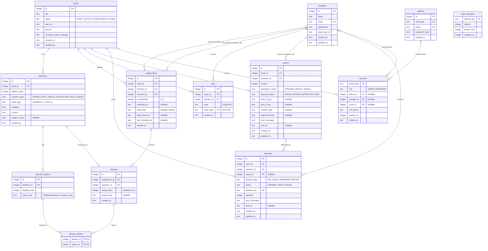

# 03. 데이터베이스 스키마 및 스토리지 명세 (Cloudflare D1 & R2)

본 문서는 **Cloudflare D1 (SQLite 호환)**, **Cloudflare R2**, **Cloudflare Queues** 기반의 데이터 모델 및 스토리지 구조 명세입니다. 실제 마이그레이션 SQL 원본은 [`migrations/0001_initial.sql`](../migrations/0001_initial.sql)에 정의되어 있습니다.

---

## 1. 스키마 설계 원칙 및 레거시 대비 변경점

| 구분 | 레거시 (`legacy-ts`) | 재설계 (`PeerFlow v2`) |
| :--- | :--- | :--- |
| **테이블 구성** | 15개 테이블 (`version_logs`, `validation_logs`, `report_input_epoch`, `demo_seed`, `jobs` 포함) | **13개 정규화 테이블** (불필요한 로그·트리거·비정형 잡 테이블 전면 폐기) |
| **비동기 작업 추적** | 단일 `jobs` 테이블의 `payload` JSON 문자열을 `json_extract()`로 조회 | 리포트 생성은 `reports` 테이블, Slack 발송은 `deliveries` 테이블의 정규화 컬럼 및 외래키로 분리 |
| **파일 저장 방식** | `reports.html`에 수 MB 텍스트 또는 `"r2:..."` 문자열 혼용, `pdf` BLOB 컬럼 보유 | D1에는 순수 R2 Object Key(`image_r2_key`, `html_r2_key`, `pdf_r2_key`)만 저장하고 본문은 R2에 저장 |
| **R2 디렉터리 구조** | `reports/1/2/...` 처럼 숫자 ID와 해시만 나열되어 식별 불가 | 회차명·이름·부서·문항 카테고리를 포함한 **사람이 읽기 쉬운 경로** 적용 |
| **임시 저장(`draft_data`)** | `{"q_12": "4", "q_15_3": "on"}` 형태의 비정형 폼 필드명 | OpenAPI `ReviewAnswersInput`과 동일한 정형 JSON 배열(`{"answers": [...]}`) |
| **선택지 중복 방지** | 빠른 연속 클릭 시 동일 선택지 중복 INSERT 발생 | `question_options`에 `UNIQUE (question_id, option_text)` 제약 및 원자적 `INSERT ... SELECT` 적용 |

---

## 2. 개체-관계 다이어그램 (ERD)



---

## 3. 테이블별 상세 명세 (13개 테이블)

1. **`admins`**: 시스템 관리자 계정 정보 (`username`, `email`, `password_hash` PBKDF2-HMAC-SHA256 해시 저장)
2. **`members`**: 리뷰어 및 피평가자가 되는 팀원 정보 (`name`, `email` UNIQUE, `department`, `slack_user_id`)
3. **`cycles`**: 피어리뷰 회차 메타데이터 및 상태 (`DRAFT`, `ACTIVE`, `COMPLETED`, `CLOSED`), 시작·마감 일시(`end_at > start_at`)
4. **`questions`**: 회차별 설문 문항 (`display_order`, `question_type`, `scale_type`, `category`, `content`, `image_r2_key`)
5. **`question_options`**: 객관식(`SINGLE_CHOICE`, `MULTIPLE_CHOICE`) 문항의 선택지 목록 (`UNIQUE (question_id, option_text)`)
6. **`assignments`**: 회차별 리뷰어-피평가자 매칭 (`UNIQUE (cycle_id, reviewer_id, reviewee_id)`, 자기 자신 평가 금지 `CHECK (reviewer_id <> reviewee_id)`, `draft_data`, `is_submitted`)
7. **`answers`**: 최종 제출된 문항별 응답 (`rating_value` 1~5 또는 `answer_text` 최대 2,000자, `UNIQUE (assignment_id, question_id)`)
8. **`answer_options`**: 객관식 문항에서 선택된 `option_id` 다대다 매핑 (`PRIMARY KEY (answer_id, option_id)`)
9. **`pins`**: 회차 시작 시 리뷰어별로 발급되는 6자리 숫자 PIN (`code` 평문은 Slack DM 발송용, 로그인 조회는 전역 유일 `code_hash` SHA-256 인덱스 사용)
10. **`reports`**: 피평가자별 리포트 생성·승인·발송 상태 (`generation_status`: `PENDING` | `READY` | `FAILED`, `approval_status`: `NEEDS_REVIEW` | `APPROVED` | `SENT`, `html_r2_key`, `pdf_r2_key`, `content_hash`, `approved_hash`)
11. **`deliveries`**: Slack DM 발송 작업 및 결과 이력 (`delivery_type`: `PIN_ISSUE` | `REMINDER` | `REPORT`, `status`: `PENDING` | `SENT` | `FAILED`, `dedupe_key` UNIQUE, `attempts`, `error_message`)
12. **`sessions`**: 관리자 및 리뷰어 인증 세션 (`token_hash` PK, `role`, `csrf_token`, `expires_at` Unix Epoch ms)
13. **`login_attempts`**: 브루트포스 방지를 위한 로그인 실패 횟수 및 잠금 시각 추적 (`attempt_key` PK, 5회 실패 시 15분 잠금)

---

## 4. Cloudflare R2 디렉터리 및 파일명 규칙

관리자가 Cloudflare R2 콘솔이나 CLI에서 버킷 내부를 직접 탐색할 때 어떤 회차의 누구 리포트인지, 몇 번 문항의 이미지인지 즉시 식별할 수 있도록 한글·영문·숫자를 보존한 슬러그(`toReadableSlug`) 기반 디렉터리 구조를 사용합니다.

| 저장 대상 | R2 Object Key 구조 | 예시 |
| :--- | :--- | :--- |
| **문항 참고 이미지** | `questions/cycle-{회차ID}_{회차제목}/Q{문항순서}_{카테고리}_{랜덤8자리}.{png\|jpg\|webp}` | `questions/cycle-1_2026_상반기_피어리뷰/Q2_성장_피드백_a1b2c3d4.png` |
| **피평가자 HTML 리포트** | `reports/cycle-{회차ID}_{회차제목}/{이름}_{부서}_id{멤버ID}/{이름}_피어리뷰_리포트.html` | `reports/cycle-1_2026_상반기_피어리뷰/김철수_백엔드_id1/김철수_피어리뷰_리포트.html` |
| **피평가자 PDF 리포트** | `reports/cycle-{회차ID}_{회차제목}/{이름}_{부서}_id{멤버ID}/{이름}_피어리뷰_리포트.pdf` | `reports/cycle-1_2026_상반기_피어리뷰/김철수_백엔드_id1/김철수_피어리뷰_리포트.pdf` |

---

## 5. Cloudflare Queues 메시지 스키마

* **`peerflow-report-queue` (`REPORT_QUEUE`)**:
  ```json
  {
    "job_type": "GENERATE_REPORT",
    "cycle_id": 1,
    "reviewee_id": 1,
    "report_id": 1,
    "revision": 1
  }
  ```
* **`peerflow-delivery-queue` (`DELIVERY_QUEUE`)**:
  ```json
  {
    "job_type": "SEND_SLACK_DELIVERY",
    "delivery_id": 1
  }
  ```
